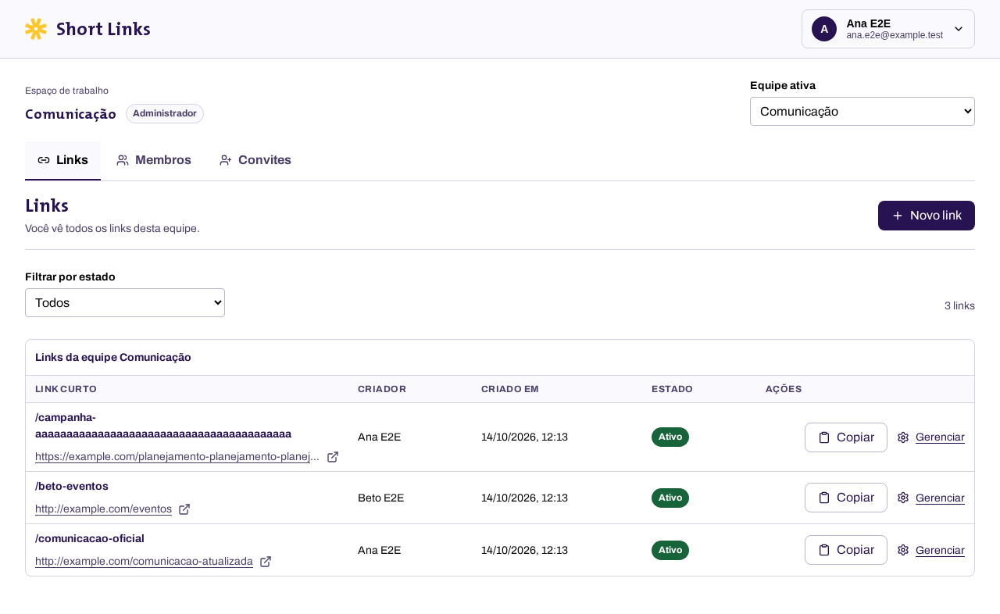

# Revisão visual da interface

Capturas reais do Short Links no Chromium, com dados do projeto
`demo-shortener`. Desktop usa 1280 × 720 px; celular usa 360 × 800 px, com
densidade de pixels do Pixel 7. As imagens completas incluem conteúdo abaixo
da primeira dobra. Datas e URLs locais são dados do ambiente de teste.

## Telas

| Tela              | Desktop                        | Celular                       |
| ----------------- | ------------------------------ | ----------------------------- |
| Login             | [Ver](desktop-login.png)       | [Ver](mobile-login.png)       |
| Primeiro acesso   | [Ver](desktop-first-team.png)  | [Ver](mobile-first-team.png)  |
| Criar link        | [Ver](desktop-create-link.png) | [Ver](mobile-create-link.png) |
| Links             | [Ver](desktop-links.png)       | [Ver](mobile-links.png)       |
| Detalhe e cliques | [Ver](desktop-link-detail.png) | [Ver](mobile-link-detail.png) |
| Membros           | [Ver](desktop-members.png)     | [Ver](mobile-members.png)     |
| Convites          | [Ver](desktop-invites.png)     | [Ver](mobile-invites.png)     |

[Ver a estrutura anterior à modernização](before-links.png).



## Validação

- `npm run validate`: arquitetura, documentação, styleguide, lint, tipos,
  cobertura, testes de backend e scripts, build e smoke HTTP.
- `npm run test:e2e`: fluxo completo em desktop e 360 px, contrato de tokens e
  regressão visual de `/styleguide` no Linux.
- Teclado: login, abertura e Escape no diálogo, foco inicial e retorno ao
  botão Novo link, gestão de estado e expansão dos dados diários.
- Entradas longas: nome de equipe, slug de 50 caracteres e URL extensa;
  a página não exige rolagem horizontal.
- Permissões: membro acessa somente seus links; administração e perda de
  associação continuam cobertas pelo fluxo emulado.

O E2E anexa as capturas em `test-results/`, permitindo regenerar a evidência
com `npm run test:e2e`. A referência Linux de `/styleguide` foi criada nesta
entrega, sem substituir a referência existente para macOS.

## Revisão interativa local

Com a configuração pública Firebase do projeto em `.env.local`, execute
`npm run dev` e abra `/login`. Para a jornada isolada com dados emulados,
execute `npm run test:e2e -- --headed --project=chromium e2e/app.spec.ts`.

## Canal de teste Firebase

O CLI deste ambiente informou `No authorized accounts`; não houve publicação.
Após disponibilizar uma sessão Firebase autorizada, usar a configuração pública
do projeto real com os emuladores desativados, recompilar e publicar somente
um canal temporário de Hosting:

```bash
npm run build:bundle
npx firebase hosting:channel:deploy interface-review --project shortener-59c85 --expires 7d
```

O comando retorna a URL do canal. Validar o login Google nesse endereço e seguir
o [runbook de operação](../operations.md). Esta entrega não modifica Rules,
Functions, dados ou o canal live.
